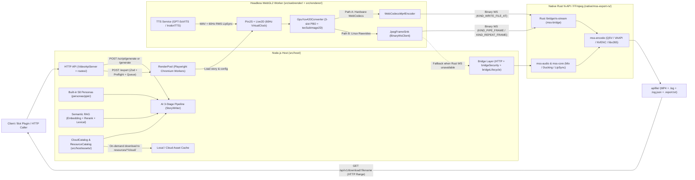

# 系统架构指南

[返回 README](../README.md) · [文档总览](README.md) · [开发与验证](development.md) · [API 参考](api.md)

MySekaiStoryteller-API 是一个单进程 Node.js 渲染宿主，对外暴露纯 HTTP API，内部编排 **AI 剧本生成管线**、**云端素材按需物化**、**Playwright 无头 WebGL2 渲染池**与**原生 Rust 导出/混音/二进制 WebSocket 桥接引擎**，最终输出符合官方 60Hz 演出语义的 MP4 视频与逐帧诊断报告。

## 总体数据流

## 核心子系统与模块边界

### 1. HTTP API 与生命周期管理（`src/host/main.ts`、`src/host/servers/`）

- **`src/host/main.ts`**：负责启动引导——在 `loadConfig()` 之前通过 `src/host/env.ts` 自动加载 `.env`（不覆盖已有进程环境变量），初始化日志、云端目录、AI `StoryWriter`、原生 Rust 桥接与 `RenderPool`，并在收到 `SIGINT` / `SIGTERM` 时触发优雅停机排空（`beginDraining()` 立即以 `503` 拒绝新请求，最多等待 120 秒让在途导出与 AI 生成收尾）。
- **`src/host/servers/VideoApiServer.ts`**：承载核心导出队列（`/api/v1/export`、`/status`、`/cancel`）、异步文件列表（`/api/v1/files`）、支持 HTTP `Range` 的防越界下载（`/api/v1/download/:filename`）、定时清理（含 `mss-segs-*` 等临时目录）以及带鉴权脱敏的 `/api/v1/health`。
- **`src/host/servers/routes/`**：
  - `assetRoutes.ts`：`/api/v1/resources`、`/api/v1/cloud/refresh`、`/api/v1/assets/moesekai/*`、`/api/v1/assets/fetch`。
  - `aiRoutes.ts`：`/api/v1/script/generate`、`/api/v1/generate` 与 AI 并发控制。
  - `ttsLeaseRoutes.ts`：GPT-SoVITS 权重互斥租约（`/api/v1/tts/lease*`）。

### 2. AI 统一三段式编剧管线（`src/host/ai/`、`src/host/rag/`、`personas/pjsk/`）

- **内置人设与自动发现（`src/host/ai/personas.ts`）**：自动加载仓库内置 `personas/pjsk/`（58 份重写 PJSK 角色人设，支持按分团消歧虚拟歌手与多目录叠加覆盖），在对白与表演阶段分别注入高密度人格约束与两两称呼表。
- **语义 RAG（`src/host/rag/`）**：`Embedding + Cross-Encoder Rerank` 两阶段召回，带增量 SQ8 磁盘缓存，并在无外部 Embedding/Rerank 服务时无缝降级为本地 BM25 + CJK 二元组词法检索。
- **模块化编剧引擎**：
  - `src/host/ai/storyWriter.ts`：统一编排 `hybrid` / `agent` / `staged` / `single` 管线。
  - `src/host/ai/agent/`（`phase1Explore.ts`、`toolkit.ts`、`actingAudit.ts`）：Phase 1 只读工具探索（`lookup_character`、`search_official_corpus`、`search_assets`）与表演保真度审计；Phase 1 结束后严格丢弃工具对话历史以隔离上下文。
  - `src/host/ai/staged/`（`types.ts`、`helpers.ts`、`cast.ts`、`dialogue.ts`、`voiceDirection.ts`、`staging.ts`、`direction.ts`、`composer.ts`、`directorReview.ts`）：Phase 2 纯净上下文写词 + 人设 Critic，Phase 3 并行声演/舞台/日语翻译、表情动作编译、`composeStory` 合成与轻量导演终审局部修补。
  - `src/host/ai/facialSemantics.ts`、`officialLinter.ts`、`validate.ts`：基于真实 `.motion3.json` 曲线校验表情/动作语义与官方剧本不变量。

### 3. 云端素材目录与按需物化（`src/host/assets/`、`src/host/resources/`）

- 启动时合并内置中文语义索引（574 模型 / 1,402 背景 / 421 BGM / 1,991 SE）与线上 Moesekai / exmeaning / Sekai-World 清单，写入 `<assets.cacheDir>/catalog.json`。
- 导出前扫描剧本引用的模型、背景、BGM、SE 与 UI 贴图，仅下载缺失项到 `resources/*/cloud/`，并将 Unity `sse-motion.json` 无损转换为 Live2D `motion3.json`。
- 支持 `assets.cloudOnly: true`（默认模板启用，完全隔离本地旧资源）与 `assets.cloudOnly: false`（本地 `resources/` 文件与 YAML 清单优先覆盖）。

### 4. 无头渲染池与 WebGL2 导出管线（`src/host/pool/`、`src/webrender/`、`src/renderer/`）

- **`RenderPool`**：维护常驻 Chromium / Edge worker 池（每 worker 独立 WebGL2 上下文），支持并发上限、热备 worker、按导出次数自动回收（防止 Live2D 纹理内存增长）与可用内存护栏。
- **确定性 60Hz 虚拟时钟（`VirtualClockController` + `src/common/official/`）**：动画、打字机、Live2D 动作混合、眨眼、呼吸与官方 60Hz RMS 口型包络严格按故事帧号推进，30fps 与 60fps 输出保持一致的演出节奏。
- **双路径零冗余编码**：
  - `GpuYuv420Converter` 使用 **3-slot PBO 异步读回**与 **`texSubImage2D` 纹理复用**在 GPU 端完成 BT.709 `I420` / `yuv420p` 色彩转换。
  - 支持硬件 `VideoEncoder` 的平台优先走 `WebCodecsMp4Encoder` 直编并通过 `BinaryWsClient`（使用模块加载期捕获的 `nativeSetTimeout`，避免被虚拟时钟死锁）写入 Rust 桥接；
  - Linux 无桌面等 WebCodecs 仅软件编码的平台自动切换 `JpegFrameSink` → Rust `/bridge/rs-stream` 二进制 WebSocket（`KIND_PIPE_FRAME=2` 单帧零批拷贝 + `KIND_REPEAT_FRAME=3` 16 字节静帧复用），不可用时自动降级 HTTP `frames-stream-*` / `image2pipe`。
- **模块化导出辅助**：`LipSyncCoordinator.ts`、`WebGLValidationProbe.ts`、`ConcurrentExportPipeline.ts`、`AudioMuxer.ts`、`ExportDiagnostics.ts` 共同完成并发 TTS 预热、音轨放置、黑屏校验与逐帧诊断输出。

### 5. 桥接层与原生 Rust 引擎（`src/host/bridge/`、`native/mss-export-rs/`）

- **桥接层模块化**：
  - `bridgeSecurity.ts`：回环 Origin 校验、桥接令牌认证、防越界真实路径解析（与 `wsHub.ts` 共用 `resolveWithExistingRealpath`）。
  - `bridgeLifecycle.ts`：worker / task 维度临时文件追踪、取消墓碑（tombstones）与文件句柄缓存回收。
  - `bridgeRoutes.ts`：Express 桥接端点与 `/bridge/binary-stream-endpoint`（下发 Rust WS 地址及安全编码参数）。
- **原生 Rust 工作区（`native/mss-export-rs/`）**：
  - `mss-core`：官方 60Hz 口型包络与基础算法。
  - `mss-audio`：多轨 WAV/BGM/SE 混音、人声自动闪避（ducking）与重采样。
  - `mss-encode`：跨平台硬件编码探测与缓存（`OnceLock` 缓存避免重复起 `ffmpeg` 探针，支持 `MSS_VAAPI_DEVICE`）、管道编码与快速合流/CRF 体积护栏。
  - `mss-bridge`：内嵌二进制 WebSocket 服务器（`/bridge/rs-stream`），直收渲染端视频分片与 `rawvideo` 帧流。
  - `mss-napi`：通过 N-API 将上述能力暴露给 Node.js 宿主进程内直接调用（不可用时自动回退 CLI / JS `ffmpeg`）。

## 典型请求时序

1. **AI 剧本并导出（`POST /api/v1/generate`）**：鉴权与限流 → 停机排空检查 → `StoryWriter`（Phase 1 工具探索 → Phase 2 纯净上下文写词 + 内置 58 份人设 + RAG → Phase 3 并行编译 + 导演终审）→ 落盘 `script-*.json` → 转入导出队列。
2. **视频导出（`POST /api/v1/export`）**：Zod Schema 校验 → 云端素材按需下载（`ensureStoryAssets`）→ Irodori 日语 `ttsText` 预检/补翻 → `RenderPool` 分配空闲 worker → 渲染端预加载模型/动作并启动 60Hz 虚拟时钟帧泵与并发 TTS → 通过 Rust `/bridge/rs-stream` 推流编码 + `mss-audio` 多轨混音 → 写入 `apifile/export-*.mp4` 与 `.log`/`.log.json`/`.report.txt` → 返回 `downloadUrl`。
